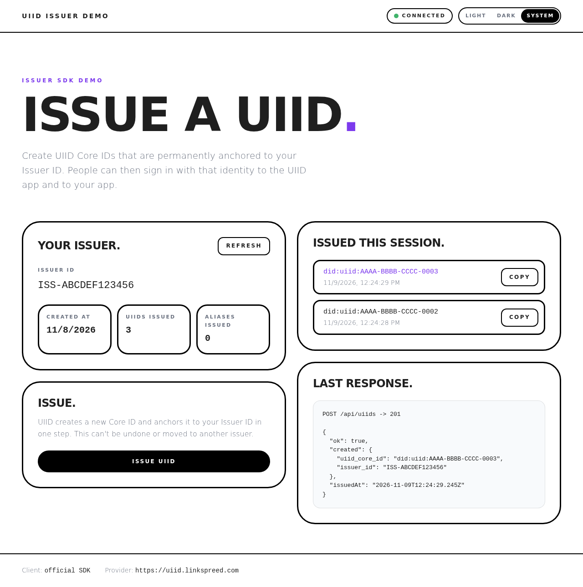

# UIID Issuer Demo

A small, dependency-free demo app for the **UIID Issuer SDK**. It lets you act as a UIID Issuer: check your Issuer ID and counters, and issue UIID Core IDs that are permanently anchored to your Issuer ID.



> This is a community demo, not an official LINKSPREED product. The issuer data in the screenshot is example data.

## What it does

- Shows your **Issuer ID**, creation date and counters from `GET /api/v1/issuer` (SDK: `getIssuer()`).
- Issues a new **UIID Core ID** with `POST /api/v1/issuer/uiids` (SDK: `createUiid()`). UIID creates the Core ID and anchors it to your Issuer ID in one step.
- Asks for confirmation before issuing, because this can't be undone.
- Shows the raw JSON of the last request, so you can see exactly what the API returns.
- Shows clear error messages, including the original text from the UIID server.
- Light, dark and system theme.

## How it works

```
Browser (public/)  ──>  Demo server (server.js)  ──>  UIID Issuer SDK  ──>  UIID API
                         holds your API key              (or REST fallback)
```

Your API key never reaches the browser. The page talks only to the local demo server, and the server calls UIID with `Authorization: Bearer <API_KEY>`.

The server uses the **official UIID Issuer SDK v1** when it is present in `vendor/`. The SDK is not committed to this repository; you download it once with `npm run sdk:fetch`, so you always run the version published by the provider. Until then, a small built-in REST client that sends exactly the same requests is used.

## Requirements

- Node.js 18.17 or newer (no `npm install` needed, there are no dependencies)
- A UIID **Company, Collective or Government** account with the Issuer program activated
- An API key of that Issuer account, created on the **same UIID instance** you point `UIID_BASE_URL` to

## Quick start

```bash
git clone https://github.com/<your-account>/uiid-issuer-demo.git
cd uiid-issuer-demo

cp .env.example .env        # Windows PowerShell: Copy-Item .env.example .env
# open .env and set UIID_ISSUER_KEY (and UIID_BASE_URL if you don't use uiid.linkspreed.com)

npm run sdk:fetch           # download the official SDK into vendor/
npm run check               # verify key and connection (issues nothing)
npm start                   # open http://127.0.0.1:3000
```

## Configuration

All settings live in `.env` (see `.env.example`).

| Variable | Default | Meaning |
|---|---|---|
| `UIID_ISSUER_KEY` | — | API key of your Issuer account. Required. Quotes and a `Bearer ` prefix are removed automatically. |
| `UIID_BASE_URL` | `https://uiid.linkspreed.com` | UIID instance. The key must come from this instance. |
| `UIID_CLIENT` | `auto` | `auto`: SDK if downloaded, else REST. `sdk`: SDK only. `rest`: REST only. |
| `HOST` | `127.0.0.1` | Address the demo server listens on. |
| `PORT` | `3000` | Port of the demo server. |

## Scripts

| Command | What it does |
|---|---|
| `npm start` | Starts the demo server. |
| `npm run check` | Checks Node version and config, then calls `GET /api/v1/issuer`. Does not issue anything. |
| `npm run sdk:fetch` | Downloads `/js/uiid-issuer-sdk.js` from `UIID_BASE_URL` into `vendor/` and prints its SHA-256. |

## Security notes

- **Issued UIIDs are permanent.** An anchored UIID can't be re-attributed to another issuer. Test with care.
- **Keep the server local.** It listens on `127.0.0.1` by default. Anyone who can reach it can issue UIIDs under your Issuer ID. Do not expose it to the internet without adding your own authentication.
- **Never commit `.env`.** It is in `.gitignore`. If a key was ever pushed, rotate it in the UIID dashboard.
- The server rejects issue requests from other websites (Origin check plus JSON-only requests), sets a strict Content Security Policy, and limits request bodies to 4 KB.
- The Issuer program stores only the Core ID and the Issuer ID. This demo stores nothing: the "Issued this session" list lives only in the browser tab.

## Troubleshooting

| Message | Cause | Fix |
|---|---|---|
| `401` – *Invalid or expired token* | UIID does not accept the key | See below. |
| `403` – *issuer_not_activated* | Issuer program not activated | Activate it in the Issuer panel of the UIID dashboard sidebar. |
| `404` | Wrong `UIID_BASE_URL` | Point it to a UIID instance with the Issuer program. |
| `network_error` | UIID not reachable | Check `UIID_BASE_URL`, your connection and proxy. |

### 401 "Invalid or expired token"

The UIID server rejected the key itself, so the problem is the key, not the demo. Check:

1. **Same instance.** A key created on one UIID instance does not work on another. `UIID_BASE_URL` must be the instance where you created the key.
2. **Right kind of key.** Use the **Issuer API key** of your Issuer account. An OAuth `client_secret` or a user access token will not work.
3. **Still valid.** If the key was regenerated or revoked, create a new one.
4. **Test without the demo.** If this also returns 401, the key is the problem:

   ```bash
   curl -i -H "Authorization: Bearer <YOUR_KEY>" <UIID_BASE_URL>/api/v1/issuer
   ```

   ```powershell
   # Windows PowerShell
   curl.exe -i -H "Authorization: Bearer <YOUR_KEY>" <UIID_BASE_URL>/api/v1/issuer
   ```

### Behind a company proxy

Node's built-in `fetch` ignores `HTTPS_PROXY` by default. On recent Node.js versions you can turn proxy support on with `NODE_USE_ENV_PROXY=1`. Node then prints an `EnvHttpProxyAgent is experimental` warning, which you can ignore.

```powershell
# Windows PowerShell
$env:HTTPS_PROXY = "http://proxy.example.com:8080"
$env:NODE_USE_ENV_PROXY = "1"
npm run check
```

If your proxy inspects TLS, also point `NODE_EXTRA_CA_CERTS` to your company root certificate.

## Project structure

```
├── server.js              # Local HTTP server: static files + small JSON API
├── lib/
│   ├── config.js          # .env loader and settings
│   ├── issuer-client.js   # Loads the official SDK, falls back to REST
│   ├── rest-issuer.js     # REST client that mirrors SDK v1
│   └── errors.js          # Turns API errors into readable messages
├── scripts/
│   ├── fetch-sdk.js       # npm run sdk:fetch
│   └── check.js           # npm run check
├── public/                # The UI (HTML, CSS, vanilla JS — "Soft Brutalism")
└── vendor/                # Official SDK goes here (not committed)
```

## License

[MIT](LICENSE)
